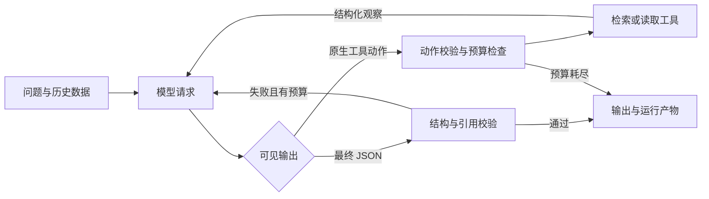

# 02 技术方案

## 模型与程序的边界

使用 Python 原生单 Agent 循环，无 Agent 框架或 SDK 编排。`ModelClient.complete(messages, tools, timeout)` 为适配边界：live 通过 HTTPX 调用配置服务的 Chat Completions 原生 function tools；mock 替换为明确标注的脚本。执行器、工具、引用校验和记录逻辑完全共用。

模型负责选择检索词、读取哪些章节、是否补查/重写、是否重试或结束。执行器不检查题号、问题固定文本或特定文档 ID 来决定业务动作，只校验协议、权限、输出和资源边界。脚本分支和演示答案只位于 `mock.py` 与测试/评估 fixture；live 不导入 Mock。

原生接口依据 [OpenAI function calling 文档](https://developers.openai.com/api/docs/guides/function-calling)：发送工具定义，取得模型 tool_calls，程序执行，再通过相同 tool_call_id 的 tool 消息回传。没有采用模型文本 action JSON。最终答案为 Pydantic 校验的 JSON，格式错误以结构化反馈回到模型。所选服务/模型须支持 Chat Completions tools；只支持 Responses API 的模型不适用于此适配器。通用 profile 无默认模型，DeepSeek profile 的文档默认值不等于已确认账号可用权限。

2026-10-30 增加 `--provider deepseek`：按 [DeepSeek 官方非思考工具调用示例](https://api-docs.deepseek.com/guides/tool_calls/) 显式关闭 thinking，标准端点省略仅供 Beta 使用的 strict。本地参数与最终引用校验不变；模型仍自行选择动作。默认地址和模型名来自 [官方接口参数](https://api-docs.deepseek.com/api/create-chat-completion/)，分别为 `https://api.deepseek.com`、`deepseek-flash`，支持环境变量覆盖；账号权限没有预设。思考模式的隐藏内容不记录/回传，意外收到时终止并报告兼容错误。

新增 `config.py` 和 `--env-file`，只显式读取指定配置，按白名单处理变量，不执行内容。进程配置优先，CLI provider 可覆盖服务商选择。真实 `.env` 和本机密钥不提交、不写入 Trace 或 meta。无密钥时配置失败；测试中使用的协议响应有明确 fixture 标记，不冒充 live。

## 数据与检索

9/10 份短合成文档，含 doc_id、title、version_date、sections[section_id,text]。D01、D02 分别记载 30/15 天，scope、supersedes、priority 均为 null，未补造适用关系。D09 的 7 个工作日是审批后的付款时限，不能替代材料提交期限。

采用 Unicode NFKC、小写、中文连续字符 bigram，英文和数字保持整词。文档与查询调用同一个 tokenizer；引用保留原文。选择字符 bigram 是为了不引入词典分词依赖，又比孤立单字更少泛化；代价是容易产生局部词面误召回，单字缩略语召回有限。候选必须有共享 token，不填充完全无匹配的 Top-k；小语料可能产生零/负 BM25 分数，仍保留确有词面匹配的候选。命中与分数不代表语义相关性或制度优先级，须由模型核对。

使用 `rank-bm25==0.2.2` 的 BM25Okapi，k1=1.5、b=0.75 为库默认值。中文预处理由本项目承担，依据 [rank_bm25 README](https://github.com/dorianbrown/rank_bm25)。P1 改进只增加少量通用短语归一化，如报账→报销、口令→密码，对文档与查询一致应用；不使用完整问题路由或答案表。评估固定 10 条人工标签，7 条开发、3 条保留，详见评估文档。

## 工具契约

| 工具 | 参数 | 成功结果 |
|---|---|---|
| search_documents | query, top_k(1..10), purpose | hits：doc_id、section_id、title、version_date、score、preview |
| read_excerpt | doc_id, section_id, purpose | 对应章节准确 text、版本、标题及原文存在的关系元数据 |

统一结果为 `{ok:true,data:{...},error:null}` 或 `{ok:false,data:null,error:{code,message,retryable}}`。空/非法查询、未知章节/工具、异常不伪装为成功；合法但无命中返回空 hits。purpose 是可核查的简短动作说明，不索取内部思维过程。

故障注入在 ToolExecutor：`first_search` 只使首次合法检索失败，`always_search` 持续失败，metadata 记载配置。工具层不重试；后续调用必须来自模型新动作。HTTP 传输也没有自动重试，因此不能把传输重试计作决策。

## 冲突、上下文与隔离

系统提示要求检索多个候选、读取矛盾双方、再找适用/替代/优先关系。日期、较短期限和检索分数不决定制度效力。未解冲突输出 needs_clarification、双方引用和问题。制度外问题有限检索后 insufficient_evidence。历史以 user 数据包传入，保留原角色标签但不作为独立系统/助手指令；重新读取文档确认依据。工具原文也作为 tool 数据，不拼进系统消息。

这是基础隔离，不是完备抗注入方案；模型是否正确识别冲突、指代及恶意指令仍待 live 评估。执行器工具白名单限制为检索和读取，数据中的命令无法直接变成 shell 工具。

## 引用与状态校验

检查文档/章节存在、版本一致、本次成功读取、quote 为非空准确连续片段、citation_id 唯一且被 claims/冲突引用时存在。answered 必须有 claims 和引用，不能同时列出未解冲突。澄清/资料不足须给出问题/缺口。错误回传模型，修复占用剩余请求预算；不能修复则输出未完成状态，并保留已读证据。

字符串存在不能证明语义支持。离线负例曾复现错误数字、冲突各方引用串位及空白成功输出；现已增加对 answer/claim/冲突各方的阿拉伯数值对应筛查与空白输出拦截，错误反馈模型后修复或受预算终止。数值筛查不是数学推理、单位换算或完整蕴含判断。测试保留同样30天却新增“仅限上海办公室正式员工”的无依据限制，当前仍可能漏检；完整语义支持需要人工审阅，不能宣传已完全解决事实一致性。

2026-10-31 增加有限数值/单位组合筛查：30年不能由30天支持，工作日与未区分的天数保持不同；未知单位、中文数字、条件、对象、否定仍不在自动保证范围。评估器现在还要求工具失败场景有真实 `SEARCH_UNAVAILABLE` 观察及后续模型请求反馈，不能只检查最终 `tool_failed` 状态。

## 本机页面

`web.py` 使用标准库 HTTP 服务并绑定127.0.0.1，静态资源随Python包打包。页面通过同源JSON接口发起任务，Live 密钥直接传给 `LiveClient`，不进入 `AgentInput`、Trace、meta 或浏览器持久存储；不读取本机配置文件。语料编辑保存为本次任务副本，不覆盖 data。人工复核与有限自动评估分别保存，PASS需主动勾选已核对证据。服务只用于本机验收，未实现多用户鉴权或公网部署。

## 预算与可观察性

max_steps 计每次模型请求（包括输出修复），max_tool_calls 逐个计失败/未知/批量工具调用。恰好到工具上限后仍可在剩余步骤内让模型输出最终结果；再次请求工具则跳过执行并 step_limit。总时限在边界检查；单 HTTP 请求设置连接/读写超时，HTTPX 的阶段超时不等同于强制总墙钟中断。

每个运行使用 UTC 时间戳加随机 run_id，新目录不覆盖。JSONL 事件即时追加并 flush；下一步只通过后来实际发生的 action 及 step 关联，不预写未来动作。model_request 含传给模型的可见完整上下文，可核对上一工具结果是否回传。Trace 不保存隐藏 reasoning，meta 不含密钥；请求 ID、token、耗时可得时记录，未知为 null。输入和语料预检失败不创建运行目录。

status 包含 answered、needs_clarification、insufficient_evidence、tool_failed、step_limit、model_error。API 不可用不会降级；异常与预算终止保留已读取的准确原文，claims 为空，避免把未完成任务包装为答案。
